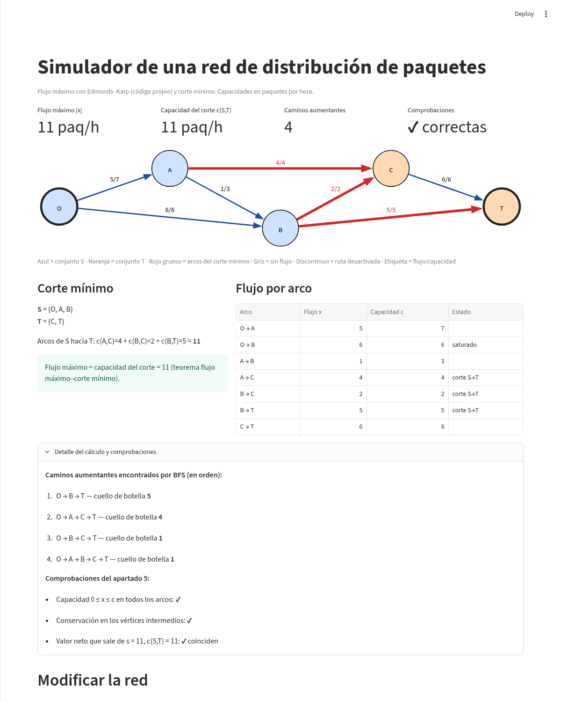

# Caso de verificación manual (apartado 5)

Archivo de datos: [`datos/caso_manual.json`](../datos/caso_manual.json). Prueba automática: `test_caso_manual` en [`tests/test_flujo.py`](../tests/test_flujo.py).

## 1. Red

V = {O, A, B, C, T}, s = O, t = T, |V| = 5, |E| = 7.

| Arco | O→A | O→B | A→B | A→C | B→C | B→T | C→T |
|---|---|---|---|---|---|---|---|
| c | 7 | 6 | 3 | 4 | 2 | 5 | 8 |

La red no tiene lazos, arcos repetidos ni recíprocos. Hay 5 caminos dirigidos de O a T. Los intervalos de 10–12 vértices y 15–20 arcos se exigen solo a la red principal, no a este caso.

## 2. Resolución manual con caminos aumentantes

Se eligen los caminos "a ojo" (sin seguir el orden de BFS):

| Paso | Camino | Capacidades residuales en el camino | δ | \|x\| |
|---|---|---|---|---|
| 1 | O → A → C → T | 7, 4, 8 | 4 | 4 |
| 2 | O → B → T | 6, 5 | 5 | 9 |
| 3 | O → A → B → C → T | 3, 3, 2, 4 | 2 | 11 |

Después del paso 3, las capacidades residuales que salen de O, A y B son:

- O → A: 7 − 6 = 1 y O → B: 6 − 5 = 1, así que se alcanzan A y B;
- A → C: 0 y A → B: 3 − 2 = 1;
- B → C: 0 y B → T: 0.

Desde {O, A, B} no se puede llegar a C ni a T, así que no queda camino aumentante.

**Flujo obtenido a mano:**

| Arco | O→A | O→B | A→B | A→C | B→C | B→T | C→T |
|---|---|---|---|---|---|---|---|
| x | 6 | 5 | 2 | 4 | 2 | 5 | 6 |
| c | 7 | 6 | 3 | 4 | 2 | 5 | 8 |

**Comprobación de factibilidad:**

- Capacidad: 0 ≤ x(u, v) ≤ c(u, v) en los 7 arcos (ver tabla).
- Conservación:
  - A: entra 6 (O→A) y sale 2 + 4 = 6 (A→B, A→C);
  - B: entra 5 + 2 = 7 (O→B, A→B) y sale 2 + 5 = 7 (B→C, B→T);
  - C: entra 4 + 2 = 6 (A→C, B→C) y sale 6 (C→T).
- Valor: |x| = x(O,A) + x(O,B) = 6 + 5 = 11, igual a lo que llega a T: x(B,T) + x(C,T) = 5 + 6 = 11.

## 3. Corte de igual capacidad

S = {O, A, B} y T = {C, T}. Los arcos de S hacia T son A→C, B→C y B→T:

c(S, T) = 4 + 2 + 5 = **11**.

No hay arcos de T hacia S. Los tres arcos del corte están saturados.

**Optimalidad.** Para todo flujo factible y todo corte se cumple |x| ≤ c(S, T). Se encontró un flujo de valor 11 y un corte de capacidad 11, por lo tanto:

- ningún flujo puede superar 11, así que el flujo es **máximo**;
- ningún corte puede tener capacidad menor que 11, así que el corte es **mínimo**.

Como comprobación adicional, estas son las capacidades de los 2³ = 8 cortes posibles (O siempre en S, T siempre en T):

| S | Arcos de S hacia T | c(S, T) |
|---|---|---|
| {O} | O→A (7) + O→B (6) | 13 |
| {O, A} | O→B (6) + A→B (3) + A→C (4) | 13 |
| {O, B} | O→A (7) + B→C (2) + B→T (5) | 14 |
| {O, C} | O→A (7) + O→B (6) + C→T (8) | 21 |
| **{O, A, B}** | **A→C (4) + B→C (2) + B→T (5)** | **11** |
| {O, A, C} | O→B (6) + A→B (3) + C→T (8) | 17 |
| {O, B, C} | O→A (7) + B→T (5) + C→T (8) | 20 |
| {O, A, B, C} | B→T (5) + C→T (8) | 13 |

El mínimo es 11, y lo alcanza un único corte.

## 4. Resultado del código

Para reproducirlo: en la aplicación, cargar `caso_manual.json` y pulsar **Calcular**. También se puede abrir `http://localhost:8501/?red=caso_manual.json&calcular=1`.

Caminos que encontró Edmonds–Karp (BFS):

| Paso | Camino | δ | \|x\| |
|---|---|---|---|
| 1 | O → B → T | 5 | 5 |
| 2 | O → A → C → T | 4 | 9 |
| 3 | O → B → C → T | 1 | 10 |
| 4 | O → A → B → C → T | 1 | 11 |

## 5. Comparación entre el cálculo manual y el código

| | Manual | Código (Edmonds–Karp) |
|---|---|---|
| Flujo máximo | 11 | 11 |
| Caminos aumentantes | 3 | 4 |
| x(O,A), x(O,B), x(A,B) | 6, 5, 2 | 5, 6, 1 |
| x(A,C), x(B,C), x(B,T), x(C,T) | 4, 2, 5, 6 | 4, 2, 5, 6 |
| Corte mínimo | S = {O, A, B}, T = {C, T} | S = {O, A, B}, T = {C, T} |
| c(S, T) | 11 | 11 |

**Diferencias encontradas.** El valor máximo y el corte mínimo coinciden. Las diferencias están en el orden de los caminos y en el flujo de O→A, O→B y A→B:

- **Orden y número de caminos.** BFS elige siempre el camino con menos arcos. Por eso empieza por O → B → T (2 arcos), mientras que a mano se empezó por O → A → C → T.
- **Flujo por arco.** Esta red tiene **más de un flujo máximo**. Los dos flujos son factibles y valen 11. Solo cambia por dónde se lleva una unidad hasta B: a mano por O → A → B, y en el código directamente por O → B.
- **Lo que sí coincide en cualquier flujo máximo.** Los arcos del corte mínimo (A→C, B→C y B→T) quedan saturados en ambas soluciones, porque todo flujo máximo debe saturar los arcos de un corte mínimo. En cambio, el flujo de los arcos que no son de corte puede variar.

En ambos procedimientos se cumplen las comprobaciones de capacidad, de conservación y de |x| = c(S, T) = 11. La aplicación muestra esas tres comprobaciones como correctas.
