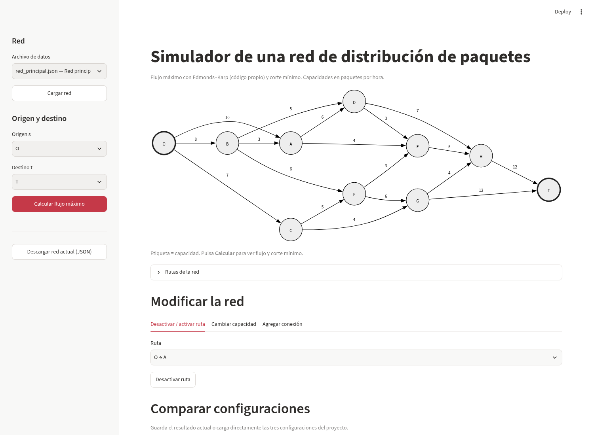
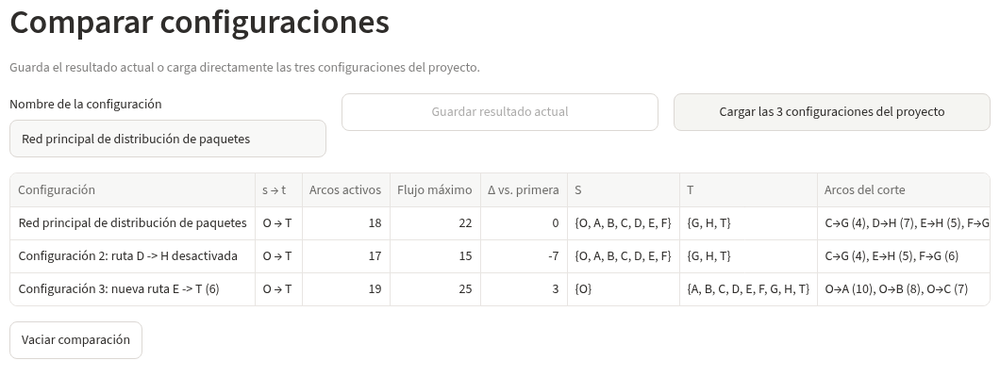
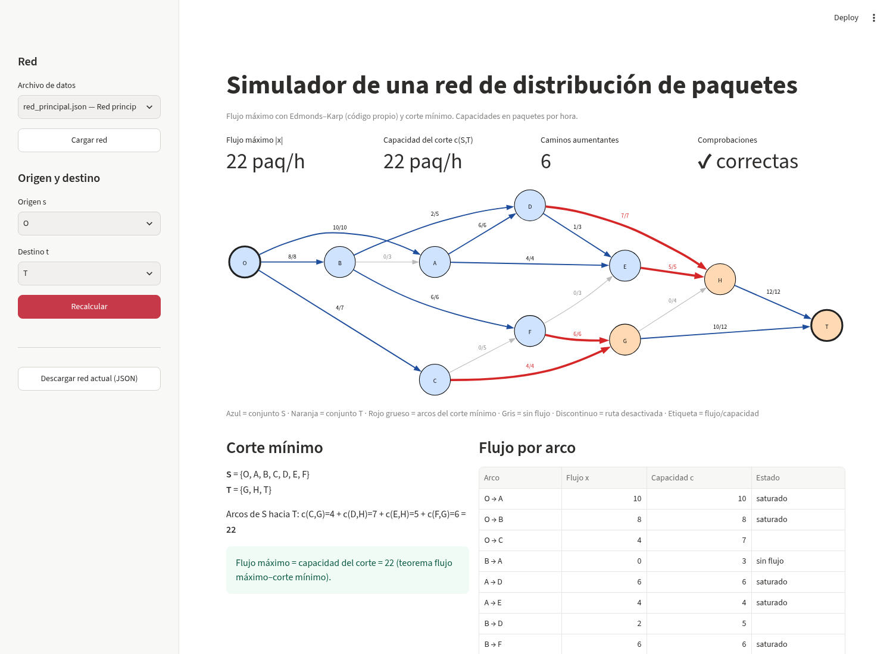
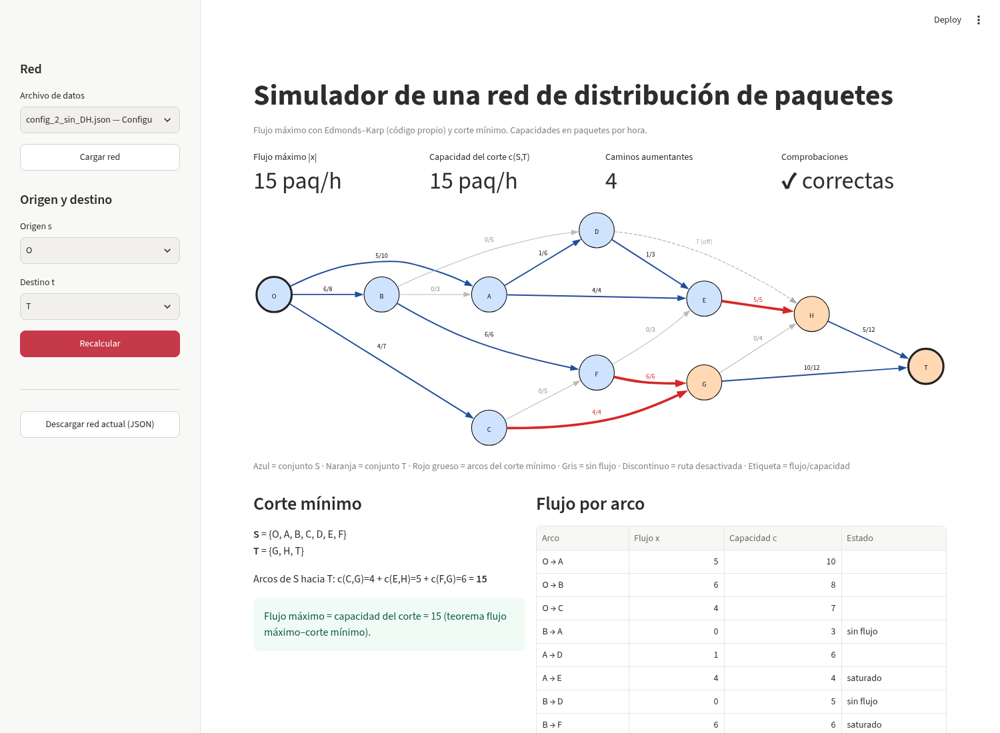
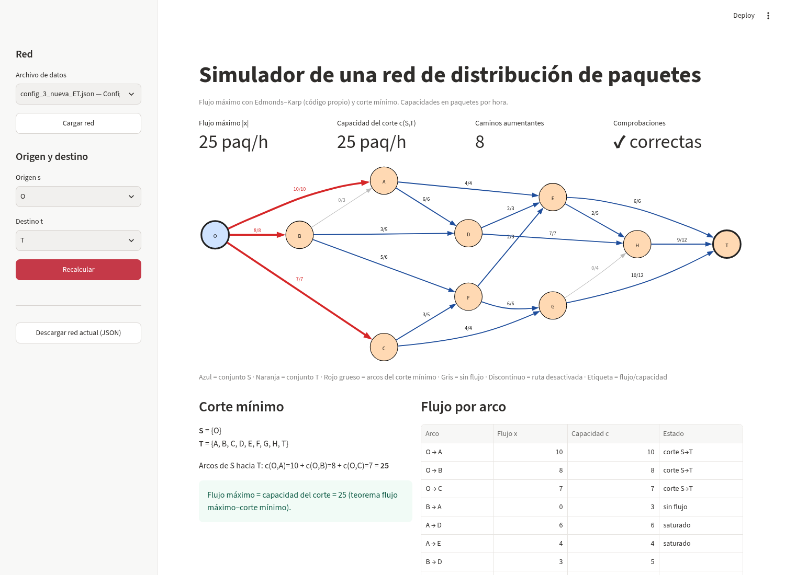

# Tarea 3 — Interfaz, simulación y resultados de las tres configuraciones

Responsable: **Persona 3**. Código: [`app.py`](../app.py) (interfaz) y [`simulador/flujo.py`](../simulador/flujo.py) (Edmonds–Karp, corte mínimo y comprobaciones).

Todas las configuraciones usan s = O y t = T. Los resultados se obtuvieron con la aplicación y se comprueban automáticamente con `python -m unittest discover tests`.

## 3.1 Interfaz

La aplicación (Streamlit) dibuja la red con el lenguaje DOT de Graphviz, que solo se usa para la representación gráfica. Ningún cálculo de flujo proviene de bibliotecas: la interfaz llama a las funciones propias de `simulador/flujo.py`.

| Elemento | Representación |
|---|---|
| Centro logístico | Círculo con su identificador. s y t tienen borde grueso |
| Ruta | Flecha u → v. Etiqueta = c antes de calcular y x/c después de calcular |
| Conjunto S / conjunto T | Centros en azul / en naranja |
| Arcos del corte mínimo (S → T) | Rojo y gruesos |
| Ruta sin flujo | Gris |
| Ruta desactivada | Discontinua gris, etiqueta "c (off)" |



## 3.2 Controles

- Barra lateral: archivo de red (`datos/*.json`), **origen s**, **destino t** y el botón **Calcular flujo máximo / Recalcular**.
- Indicadores: flujo máximo |x|, capacidad del corte c(S, T), número de caminos aumentantes y resultado de las comprobaciones.
- Panel **Corte mínimo**: S, T y la suma de capacidades de los arcos de S hacia T.
- Tabla **Flujo por arco**: x(u, v), c(u, v) y estado (corte, saturado, sin flujo).
- Desplegable **Detalle del cálculo**: los caminos aumentantes que encontró BFS, en orden, y las tres comprobaciones del apartado 5 (capacidad, conservación y |x| = c(S, T)).
- Si se modifica la red o se cambia s o t después de calcular, la aplicación avisa de que el resultado está desactualizado hasta que se pulse **Recalcular**.

Para la demo, la URL `http://localhost:8501/?red=config_2_sin_DH.json&calcular=1` abre una configuración ya calculada.

## 3.3 Modificaciones desde la interfaz

| Acción | Validación |
|---|---|
| Desactivar / activar ruta | Al reactivar una ruta se rechaza si ya existe la ruta recíproca activa |
| Cambiar capacidad | Solo enteros entre 1 y 12 |
| Agregar conexión | Se rechazan lazos (u = v), arcos repetidos (si existe desactivado, se indica que se active) y arcos recíprocos (si existe v → u) |

Cada modificación muestra un mensaje de confirmación o de rechazo con su motivo. La red modificada se puede descargar como JSON con el mismo formato de `datos/`. Además, la aplicación muestra las observaciones del validador (`datos/validar_red.py`) sobre la red actual, por ejemplo si un vértice quedó aislado.

## 3.4 Las tres configuraciones

| # | Configuración | Archivo | Arcos activos | Flujo máximo | Corte mínimo (S \| T) | Arcos del corte |
|---|---|---|---|---|---|---|
| 1 | Red inicial | `red_principal.json` | 18 | **22** | {O, A, B, C, D, E, F} \| {G, H, T} | C→G (4) + D→H (7) + E→H (5) + F→G (6) = 22 |
| 2 | Cierre de la ruta D → H | `config_2_sin_DH.json` | 17 | **15** | {O, A, B, C, D, E, F} \| {G, H, T} | C→G (4) + E→H (5) + F→G (6) = 15 |
| 3 | Nueva ruta E → T con c = 6 | `config_3_nueva_ET.json` | 19 | **25** | {O} \| {A, …, H, T} | O→A (10) + O→B (8) + O→C (7) = 25 |

En las tres configuraciones el código comprueba que 0 ≤ x ≤ c en cada arco, que se conserva el flujo en los vértices intermedios y que |x| = c(S, T).



### Configuración 1: red inicial (flujo máximo 22)



Caminos aumentantes que encontró Edmonds–Karp, en orden:

| # | Camino | Cuello de botella |
|---|---|---|
| 1 | O → C → G → T | 4 |
| 2 | O → A → D → H → T | 6 |
| 3 | O → A → E → H → T | 4 |
| 4 | O → B → D → H → T | 1 |
| 5 | O → B → F → G → T | 6 |
| 6 | O → B → D → E → H → T | 1 |
| | **Total** | **22** |

Flujo resultante: O→A 10/10, O→B 8/8, O→C 4/7, B→A 0/3, A→D 6/6, A→E 4/4, B→D 2/5, B→F 6/6, C→F 0/5, C→G 4/4, D→E 1/3, D→H 7/7, E→H 5/5, F→E 0/3, F→G 6/6, G→H 0/4, G→T 10/12, H→T 12/12.

**Interpretación.** La salida de O admite 25 paquetes/hora, pero la red no puede llevarlos hasta T. La restricción está en las cuatro rutas que entran al grupo final {G, H, T}: C→G, D→H, E→H y F→G suman 22 y quedan saturadas. Las rutas G→T y H→T (12 cada una) no limitan, porque nunca reciben más de lo que entra a G y a H. Por eso aumentar una ruta que no está en el corte no cambia el resultado. Por ejemplo, si O→A pasa de 10 a 12, el flujo máximo sigue siendo 22.

### Configuración 2: cierre de la ruta D → H (flujo máximo 15, −7)



Representa la interrupción de la ruta D → H (por ejemplo, un corte de carretera). Se desactiva desde la pestaña **Desactivar / activar ruta**.

Caminos aumentantes: O→C→G→T (4), O→A→E→H→T (4), O→B→F→G→T (6) y O→A→D→E→H→T (1). Total: 15.

**Interpretación.** D → H formaba parte del corte mínimo, así que su cierre se nota directamente en la capacidad total. La red pierde los 7 paquetes/hora completos, no menos, por estos motivos:

- El corte {O, …, F} | {G, H, T} pierde ese arco y su capacidad baja de 22 a 22 − 7 = 15. Esto da la cota superior: el flujo máximo no puede superar 15.
- La única salida alternativa de D es D → E (3), y desde E solo se llega a H por E → H, que ya estaba saturada en la red inicial. Ese flujo no tiene otra ruta hacia el grupo {G, H, T}.
- La partición S | T no cambia. La red sigue limitada en el mismo punto, ahora con una entrada menos.

Lectura operativa: D → H es una ruta crítica. Cualquier reducción de su capacidad se traslada uno a uno a la capacidad total de la red, porque no existen rutas de respaldo con capacidad libre hacia H.

### Configuración 3: nueva ruta E → T con capacidad 6 (flujo máximo 25, +3)



Representa la apertura de un despacho directo desde el centro E al destino. Se agrega desde la pestaña **Agregar conexión** (E → T, 6).

Caminos aumentantes: O→A→E→T (4), O→C→G→T (4), O→A→D→E→T (2), O→A→D→H→T (4), O→B→D→H→T (3), O→B→F→G→T (5), O→C→F→G→T (1) y O→C→F→E→H→T (2). Total: 25.

**Interpretación.** La nueva ruta cruza el antiguo corte. Ese corte pasa a valer 22 + 6 = 28, pero el flujo solo sube a 25 (+3, no +6), porque el cuello de botella se traslada:

- Ahora el corte mínimo es S = {O}: las tres salidas del origen (10 + 8 + 7 = 25) quedan saturadas. La red ya entrega todo lo que el origen puede despachar.
- E → T va llena (6/6), pero H → T baja de 12 a 9. Parte del flujo que antes pasaba por H ahora sale por E, y solo 3 unidades son capacidad realmente nueva.
- Agregar más rutas internas ya no aumentaría el flujo. Para seguir creciendo habría que ampliar las salidas de O.

### Conclusiones de la comparación

| | Config. 1 | Config. 2 | Config. 3 |
|---|---|---|---|
| Flujo máximo | 22 | 15 (−7) | 25 (+3) |
| Dónde está la restricción | Entrada al grupo {G, H, T} | La misma, con una ruta menos | Salida del origen O |
| ¿Cambió la partición? | — | No | Sí |

1. Una modificación solo cambia el flujo máximo si afecta a un arco de **algún** corte mínimo. Cerrar D → H, que está en el corte, cuesta toda su capacidad. Ampliar O → A, que no está en el corte, no aporta nada.
2. Al ampliar la red, la mejora queda acotada por el **siguiente** corte más pequeño. En la configuración 3, la mejora se detiene en 25 = c({O}, V \ {O}).
3. En todos los casos se verificó |x| = c(S, T), como establece el teorema de flujo máximo–corte mínimo.

## 3.5 Reproducir los resultados

```bash
pip install -r requirements.txt
streamlit run app.py                  # interfaz
python -m unittest discover tests     # comprueba 14, 22, 15 y 25
```

En la interfaz, el botón **Cargar las 3 configuraciones del proyecto** genera la tabla comparativa.
